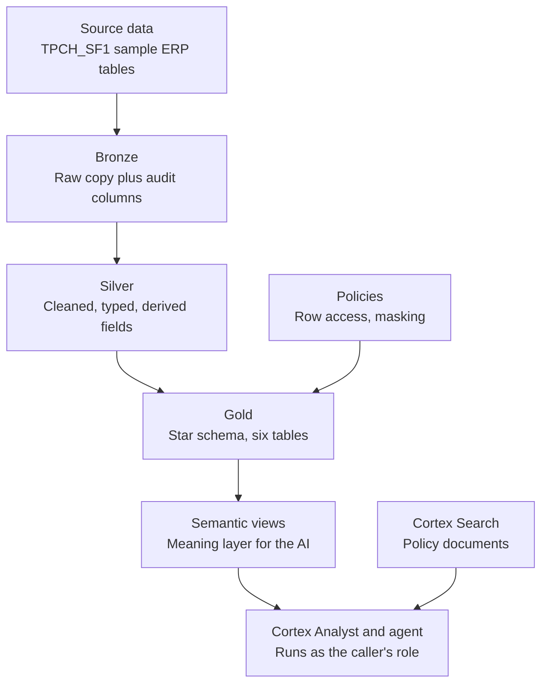
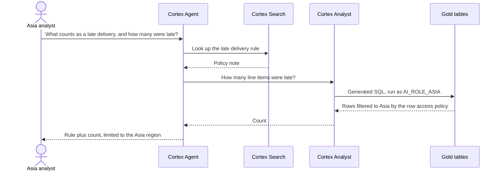
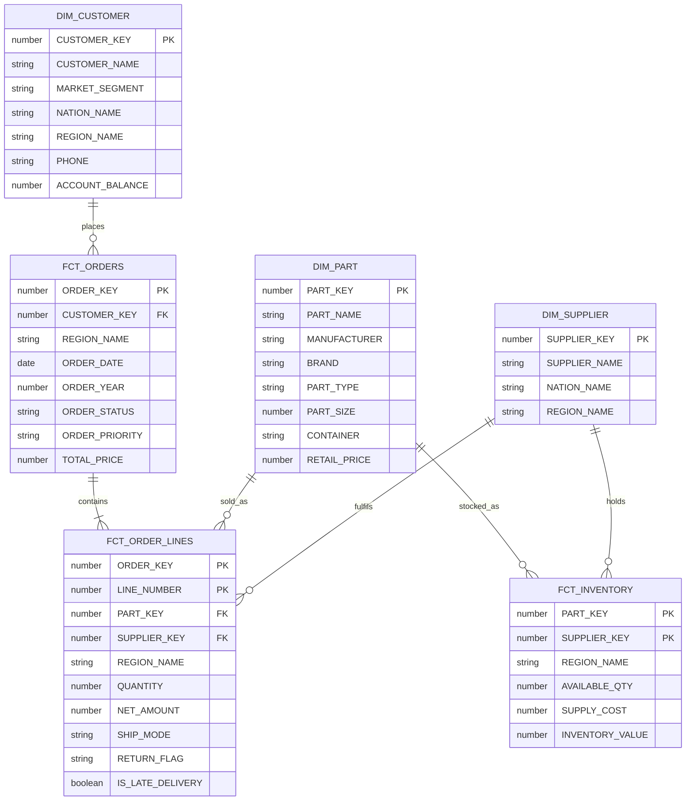
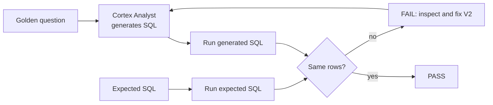

# Governed "Talk to Your Data" on Snowflake

> An ERP-style dataset flows through a **Bronze → Silver → Gold** medallion model built with Dynamic Tables, is secured with **row access and masking policies**, is described to AI through **semantic views**, and is queried in plain English by a **Cortex Agent** that combines **Cortex Analyst** (numbers) with **Cortex Search** (policy documents). A **31-question golden test set** measures accuracy before and after improving the semantic model.

**What makes this project different from a typical chatbot demo**

| Typical demo | This project |
|---|---|
| Ask a question, show an answer | Measures accuracy with an executable test set (V1 baseline vs V2 refined) |
| One user sees everything | Same question returns different answers per role (row access + masking) |
| AI queries raw tables | AI queries a modeled star schema through a semantic layer |
| No cost thinking | Resource monitor, suspend and resume scripts, cost notes |

---

## Table of contents

1. [Architecture](#1-architecture)
2. [Repository structure](#2-repository-structure)
3. [Prerequisites](#3-prerequisites)
4. [Quick start](#4-quick-start)
5. [Data model](#5-data-model)
6. [Layer by layer: source to Gold](#6-layer-by-layer-source-to-gold)
7. [Governance](#7-governance)
8. [Semantic views: V1 and V2](#8-semantic-views-v1-and-v2)
9. [Cortex Search and the agent](#9-cortex-search-and-the-agent)
10. [Evaluation](#10-evaluation)
11. [Reconciliation checks](#11-reconciliation-checks)
12. [Cost management](#12-cost-management)
13. [Troubleshooting](#13-troubleshooting)
14. [Interview talking points](#14-interview-talking-points)
15. [Limitations and future work](#15-limitations-and-future-work)
16. [Data and licensing notes](#16-data-and-licensing-notes)

---

## 1. Architecture



| Layer | Objects | Purpose |
|---|---|---|
| Source | `SNOWFLAKE_SAMPLE_DATA.TPCH_SF1` | Built-in ERP-style orders, customers, parts, suppliers |
| Bronze | `RAW_*` (8 tables) | Exact copy plus `_LOADED_AT` and `_SOURCE` |
| Silver | 7 Dynamic Tables | Renamed columns, null keys removed, derived `NET_AMOUNT` and `IS_LATE_DELIVERY` |
| Gold | 3 dimensions, 3 facts (Dynamic Tables) | Business-ready star schema with `REGION_NAME` on every table |
| Governance | `RAP_REGION`, `MASK_PHONE`, `ROLE_REGION_MAP` | Region-based row filtering, phone masking |
| Semantic | `SALES_SV_V1`, `SALES_SV_V2` | Names, joins, dimensions and metrics for Cortex Analyst |
| Search | `POLICY_SEARCH` over `POLICY_NOTES` | Answers policy and definition questions |
| Agent | `SALES_AGENT` | Orchestrates Analyst and Search |

### What happens when someone asks a question



Security is applied on the data, so the agent cannot bypass it. The same question from the global role returns all regions.

---

## 2. Repository structure

```
.
├── README.md
├── 00_setup.sql              Roles, warehouse, resource monitor, schemas, grants
├── 01_bronze.sql             Raw layer from TPCH_SF1
├── 02_silver.sql             Cleaned Dynamic Tables
├── 03_gold.sql               Star schema Dynamic Tables
├── 04_governance.sql         Row access + masking policies, with proof queries
├── 05_semantic_views.sql     SALES_SV_V1 (baseline) and SALES_SV_V2 (refined)
├── 06_docs_and_search.sql    Synthetic policy notes + Cortex Search service
├── 07_agent.sql              Cortex Agent (Analyst + Search)
├── 08_eval_snowsight.sql     Evaluation tables + RECORD_RESULT procedure (Snowsight-only)
├── eval_questions.py         31 golden questions with expected SQL
├── evaluate.py               Automated evaluation using the Cortex Analyst REST API
└── requirements.txt
```

---

## 3. Prerequisites

- A Snowflake account with Cortex features available in your region (trial accounts work for this project).
- `ACCOUNTADMIN` access for the one-time setup in `00_setup.sql`.
- Access to `SNOWFLAKE_SAMPLE_DATA` (granted to `PUBLIC` by default).
- Optional, for `evaluate.py`: Python 3.9+, a programmatic access token restricted to `AI_ROLE_GLOBAL`.

If Cortex models are missing in your region, enable cross-region inference (a commented line in `00_setup.sql`).

---

## 4. Quick start

| Step | File | Run as | What it does |
|---|---|---|---|
| 1 | `00_setup.sql` | ACCOUNTADMIN, then SYSADMIN | Roles, warehouse, resource monitor, schemas, grants |
| 2 | `01_bronze.sql` | SYSADMIN | Raw layer |
| 3 | `02_silver.sql` | SYSADMIN | Cleaned layer |
| 4 | `03_gold.sql` | SYSADMIN | Star schema |
| 5 | `04_governance.sql` | SYSADMIN | Policies, then role-by-role proof queries |
| 6 | `05_semantic_views.sql` | SYSADMIN | V1 and V2 semantic views |
| 7 | `06_docs_and_search.sql` | SYSADMIN | Policy notes and search service |
| 8 | `07_agent.sql` | SYSADMIN | Agent |
| 9 | `08_eval_snowsight.sql` | SYSADMIN | Evaluation tables and procedure |

Then:

1. Switch to `AI_ROLE_GLOBAL` for testing. Use `SYSADMIN` only to create objects, and `ACCOUNTADMIN` only for the first setup.
2. Open **AI & ML → Agents → SALES_AGENT** and ask the demo questions below.
3. Run the evaluation for `SALES_SV_V1`, then `SALES_SV_V2` (section 10).

**Demo questions** (ask as `AI_ROLE_GLOBAL`, then repeat as `AI_ROLE_ASIA`):

1. What is our net revenue by region?
2. Top 5 customers by revenue
3. What does order status F mean, and how many fulfilled orders were there in 1996?
4. What counts as a late delivery, and how many line items were late?
5. Show me the phone number of the top customer

---

## 5. Data model

The Gold layer is a **star schema**: dimensions (who, what, where) around fact tables (events and measurements).



### Grain (what one row means)

| Table | One row per | Type |
|---|---|---|
| `FCT_ORDERS` | customer order | Fact |
| `FCT_ORDER_LINES` | line item on an order | Fact |
| `FCT_INVENTORY` | part and supplier combination | Fact (snapshot) |
| `DIM_CUSTOMER` | customer | Dimension |
| `DIM_PART` | part | Dimension |
| `DIM_SUPPLIER` | supplier | Dimension |

### Relationships

| From (many) | To (one) | Join column |
|---|---|---|
| `FCT_ORDERS` | `DIM_CUSTOMER` | `CUSTOMER_KEY` |
| `FCT_ORDER_LINES` | `FCT_ORDERS` | `ORDER_KEY` |
| `FCT_ORDER_LINES` | `DIM_PART` | `PART_KEY` |
| `FCT_ORDER_LINES` | `DIM_SUPPLIER` | `SUPPLIER_KEY` |
| `FCT_INVENTORY` | `DIM_PART` | `PART_KEY` |
| `FCT_INVENTORY` | `DIM_SUPPLIER` | `SUPPLIER_KEY` |

Composite keys: `FCT_ORDER_LINES` is (`ORDER_KEY`, `LINE_NUMBER`) and `FCT_INVENTORY` is (`PART_KEY`, `SUPPLIER_KEY`).

### Design decisions

1. **`REGION_NAME` is repeated on facts and dimensions.** A row access policy can only filter on a column that exists in the table it protects. Orders and lines carry the customer's region, and inventory carries the supplier's region.
2. **Revenue lives only on `FCT_ORDER_LINES`.** Summing order totals after joining to lines would multiply each order by its line count.
3. **`ORDER_YEAR` is pre-computed.** This is a lightweight stand-in for a date dimension.
4. **Codes stay raw in Gold** (`ORDER_STATUS` F/O/P, `RETURN_FLAG` R/A/N). Their meaning is documented in the semantic view, which is what the V1 versus V2 comparison measures.
5. **Gold facts are built from Silver, not from other Gold tables.** Policies on Gold must not change what downstream Dynamic Tables compute.
6. **`FCT_INVENTORY` has no order link.** It describes stock, not sales.

---

## 6. Layer by layer: source to Gold

| Hop | What changes | File |
|---|---|---|
| Source → Bronze | Exact copy of 8 tables plus `_LOADED_AT` and `_SOURCE` | `01_bronze.sql` |
| Bronze → Silver | Columns renamed (`C_CUSTKEY` → `CUSTOMER_KEY`), null keys filtered, `NET_AMOUNT` and `IS_LATE_DELIVERY` derived, region names in title case | `02_silver.sql` |
| Silver → Gold | Joins resolved, `REGION_NAME` attached everywhere, `ORDER_YEAR` and `INVENTORY_VALUE` computed | `03_gold.sql` |

Silver uses `TARGET_LAG = DOWNSTREAM` (refreshes only as often as Gold needs). Gold uses `TARGET_LAG = '1 hour'`. Dynamic Tables load their data when created, so the lag only controls staleness after that.

**One column traced end to end: revenue**

| Layer | Object and column | Logic |
|---|---|---|
| Source | `LINEITEM.L_EXTENDEDPRICE`, `L_DISCOUNT` | raw values |
| Bronze | `RAW_LINEITEM` | unchanged |
| Silver | `ORDER_LINES.NET_AMOUNT` | `ROUND(L_EXTENDEDPRICE * (1 - L_DISCOUNT), 2)` |
| Gold | `FCT_ORDER_LINES.NET_AMOUNT` | carried through |
| Semantic | metric `lines.net_revenue` | `SUM(lines.NET_AMOUNT)`, synonyms "revenue", "sales" |

---

## 7. Governance

Rules live **on the data**, not in the AI, so every tool that queries Gold obeys them.

| Role | Rows visible | Phone number |
|---|---|---|
| `AI_ROLE_GLOBAL` | all regions | real |
| `AI_ROLE_ASIA` | Asia only | masked (`XXX-XXX-1234`) |
| `AI_ROLE_EUROPE` | Europe only | masked |

| Object | Type | How it works |
|---|---|---|
| `ROLE_REGION_MAP` | table | Maps `AI_ROLE_ASIA` → Asia, `AI_ROLE_EUROPE` → Europe |
| `RAP_REGION` | row access policy | Shows a row if the role includes `AI_ROLE_GLOBAL`, or the row's region matches the role's mapped region |
| `MASK_PHONE` | masking policy | Real value for the global role, last four digits only for everyone else |

The policy attaches to `REGION_NAME` on `DIM_CUSTOMER`, `DIM_SUPPLIER`, `FCT_ORDERS`, `FCT_ORDER_LINES` and `FCT_INVENTORY`, and the masking policy attaches to `DIM_CUSTOMER.PHONE`.

`SYSADMIN` inherits all three analyst roles, so the object owner can see every row. `ACCOUNTADMIN` does **not** inherit them, so it sees no rows in Gold. Use `AI_ROLE_GLOBAL` or `SYSADMIN` for testing.

**Proof queries** (run in `04_governance.sql`, take screenshots):

```sql
USE ROLE AI_ROLE_ASIA; USE WAREHOUSE AI_LAB_WH;
SELECT REGION_NAME, COUNT(*) FROM AI_LAB.GOLD.FCT_ORDERS GROUP BY 1;   -- only Asia
SELECT CUSTOMER_NAME, PHONE FROM AI_LAB.GOLD.DIM_CUSTOMER LIMIT 3;     -- masked
```

---

## 8. Semantic views: V1 and V2

Both views sit on the same six Gold tables with the same skeleton. They differ only in how much business meaning is written in.

| Section | Contents | Count |
|---|---|---|
| `TABLES` | `orders`, `lines`, `customers`, `parts`, `suppliers`, `inventory` with primary keys | 6 |
| `RELATIONSHIPS` | the six joins in section 5 | 6 |
| `DIMENSIONS` | things to group or filter by | 20 |
| `METRICS` | aggregate calculations | 13 |

- **V1** has structure only: no comments, no synonyms.
- **V2** adds synonyms, definitions, value lists and code meanings.

### Dimensions vs metrics

- A **dimension** is something you group or filter by (`WHERE`, `GROUP BY`).
- A **metric** is an aggregate (`SUM`, `COUNT`, `AVG`, `MAX`).

"Net revenue by region" means metric = net revenue, dimension = region.

```sql
lines.net_revenue AS SUM(lines.NET_AMOUNT)
   WITH SYNONYMS = ('revenue', 'sales', 'net sales', 'turnover')
   COMMENT = 'Revenue after discount ...'
```

### The 20 dimensions

| Table | Dimension | Source | Kind | Notes |
|---|---|---|---|---|
| customers | `customer_name` | `CUSTOMER_NAME` | name | many values, use with top-N |
| customers | `market_segment` | `MARKET_SEGMENT` | category | AUTOMOBILE, BUILDING, FURNITURE, HOUSEHOLD, MACHINERY |
| customers | `customer_nation` | `NATION_NAME` | category | |
| customers | `customer_region` | `REGION_NAME` | category | Africa, America, Asia, Europe, Middle East |
| customers | `customer_phone` | `PHONE` | attribute | masked for non-global roles |
| parts | `part_name` | `PART_NAME` | name | |
| parts | `brand` | `BRAND` | category | `Brand#23` format |
| parts | `manufacturer` | `MANUFACTURER` | category | |
| parts | `part_type` | `PART_TYPE` | text | phrases such as STANDARD POLISHED BRASS, use `LIKE` |
| suppliers | `supplier_name` | `SUPPLIER_NAME` | name | |
| suppliers | `supplier_nation` | `NATION_NAME` | category | |
| suppliers | `supplier_region` | `REGION_NAME` | category | |
| orders | `order_date` | `ORDER_DATE` | time (day) | 1992 to 1998 |
| orders | `order_year` | `ORDER_YEAR` | time (year) | |
| orders | `order_month` | `DATE_TRUNC('month', ORDER_DATE)` | time (month) | an expression |
| orders | `order_status` | `ORDER_STATUS` | code | F, O, P |
| orders | `order_priority` | `ORDER_PRIORITY` | code | 1-URGENT to 5-LOW |
| lines | `ship_mode` | `SHIP_MODE` | category | AIR, FOB, MAIL, RAIL, REG AIR, SHIP, TRUCK |
| lines | `return_flag` | `RETURN_FLAG` | code | R, A, N |
| lines | `is_late_delivery` | `IS_LATE_DELIVERY` | boolean | |

Dimension kinds behave differently. Category values need exact spelling because string comparison is case-sensitive. Codes need a translation. Names have many values and suit ranking. Time dimensions exist at three grains, so "by year" uses `order_year` and "by month" uses `order_month`.

### The 13 metrics

| Table | Metric | Expression | Additive? |
|---|---|---|---|
| orders | `order_count` | `COUNT(ORDER_KEY)` | yes |
| orders | `avg_order_value` | `AVG(TOTAL_PRICE)` | no |
| orders | `max_order_value` | `MAX(TOTAL_PRICE)` | no |
| lines | `net_revenue` | `SUM(NET_AMOUNT)` | yes |
| lines | `total_quantity` | `SUM(QUANTITY)` | yes |
| lines | `avg_line_quantity` | `AVG(QUANTITY)` | no |
| lines | `line_count` | `COUNT(LINE_NUMBER)` | yes |
| customers | `customer_count` | `COUNT(CUSTOMER_KEY)` | yes |
| customers | `avg_account_balance` | `AVG(ACCOUNT_BALANCE)` | no |
| parts | `part_count` | `COUNT(PART_KEY)` | yes |
| suppliers | `supplier_count` | `COUNT(SUPPLIER_KEY)` | yes |
| inventory | `total_available_qty` | `SUM(AVAILABLE_QTY)` | yes |
| inventory | `total_inventory_value` | `SUM(INVENTORY_VALUE)` | yes |

Totals and counts can be added across groups. Averages and maximums cannot, so the semantic view recalculates them from base rows at whatever grain is asked.

### Which dimensions work with which metrics

A metric can be sliced by dimensions on its own table, or on tables it reaches by following relationships toward the "one" side.

| Metric table | Can be sliced by dimensions from |
|---|---|
| lines (revenue) | lines, orders, customers, parts, suppliers |
| orders (order count) | orders, customers |
| inventory (stock) | inventory, parts, suppliers |
| customers, parts, suppliers | their own table |

Works: revenue by brand, revenue by customer region, inventory value by supplier region. Does not work: inventory by customer region (no path), order count by brand (an order has many lines, so the join would multiply orders). The agent should say it cannot answer these, which makes a good extra test question.

### What V2 adds

| Addition | Example | Problem it solves |
|---|---|---|
| Metric synonyms | "revenue", "sales", "turnover" for `net_revenue` | users do not say `net_revenue` |
| Metric definition | revenue is net of discount and is the default | avoids using `TOTAL_PRICE` instead |
| Code meanings | F = fulfilled, O = open, P = partially fulfilled | the AI cannot know a code's meaning |
| Value lists | regions, ship modes, segments | string filters are case-sensitive |
| Phrase mappings | "returned items" means `R`, "urgent" means `1-URGENT` | translates phrases into filter values |
| Disambiguation | "region" means customer region, "supplier geography" means supplier region | two region columns exist |
| Pattern hints | use `LIKE` for BRASS, COPPER, STEEL | part types are phrases |

### Inspect the view

```sql
DESCRIBE SEMANTIC VIEW AI_LAB.SEMANTIC.SALES_SV_V2;

SELECT * FROM SEMANTIC_VIEW(
  AI_LAB.SEMANTIC.SALES_SV_V2
  DIMENSIONS customers.customer_region, orders.order_year
  METRICS lines.net_revenue
)
WHERE ORDER_YEAR = 1997
ORDER BY 1;
```

### Known gaps (candidates for a V3)

1. **Customers who placed orders:** `customer_count` counts the customer table. Add `orders.ordering_customers AS COUNT(DISTINCT orders.CUSTOMER_KEY)`.
2. **Late delivery rate:** add `lines.late_delivery_rate AS AVG(IFF(lines.IS_LATE_DELIVERY, 1, 0))`.
3. **Discount questions:** `DISCOUNT` is not carried into Gold, so these cannot be answered. This is a modeling gap, not an AI failure.

---

## 9. Cortex Search and the agent

**Cortex Search** indexes eight short synthetic policy documents (order status codes, late delivery SLA, discount approval, returns, reorder thresholds, customer segments, priority levels, regional data access). It matches by meaning, so "when is a shipment delayed" finds the late delivery note without the exact words.

**The agent** (`SALES_AGENT`) has two tools:

| Tool | Backing object | Used for |
|---|---|---|
| `SalesAnalyst` | Cortex Analyst + `SALES_SV_V2` | questions about numbers |
| `PolicySearch` | `POLICY_SEARCH` | definitions, policies, thresholds |

For mixed questions the agent looks up the rule first, then runs the numbers. It runs queries as the **caller's role**, so the row access and masking policies apply to every answer.

If `CREATE AGENT` fails in your account, create the same agent in Snowsight (**AI & ML → Agents**) with the same two tools and the instruction text from `07_agent.sql`.

---

## 10. Evaluation

The golden set has **31 questions** with hand-written expected SQL against the Gold tables.

| Category | Questions | Tests |
|---|---|---|
| simple | 6 | single aggregates |
| group_by | 9 | grouping and joins |
| top_n | 4 | ranking |
| filter | 6 | filter values, patterns, `IN` |
| code_semantics | 4 | meaning of codes (F/O/P, R) |
| time | 2 | month grain and averages |



### Option A: entirely in Snowsight (no Python)

1. Run `08_eval_snowsight.sql` as `SYSADMIN` (creates `EVAL_QUESTIONS`, `EVAL_RESULTS` and the `RECORD_RESULT` procedure).
2. As `AI_ROLE_GLOBAL`, ask each question in **Cortex Analyst** using `SALES_SV_V1`, copy the generated SQL, then record it:
   ```sql
   CALL AI_LAB.GOVERNANCE.RECORD_RESULT(1, 'v1', $$ <paste generated SQL> $$);
   ```
3. Repeat for `SALES_SV_V2` with label `'v2'`.
4. Scoreboard:
   ```sql
   SELECT VIEW_LABEL, COUNT(*) AS total, COUNT_IF(STATUS = 'PASS') AS passed,
          ROUND(100 * passed / total) AS accuracy_pct
   FROM AI_LAB.GOVERNANCE.EVAL_RESULTS GROUP BY 1 ORDER BY 1;
   ```

The procedure compares result sets in both directions with `MINUS`. It requires the same columns in the same order as the expected SQL. If an answer is right but has an extra column, override it after checking:

```sql
UPDATE AI_LAB.GOVERNANCE.EVAL_RESULTS SET STATUS = 'PASS' WHERE Q_ID = 7 AND VIEW_LABEL = 'v1';
```

### Option B: automated with Python

```bash
pip install -r requirements.txt
export SNOWFLAKE_ACCOUNT=myorg-myaccount SNOWFLAKE_USER=... SNOWFLAKE_PAT=...
python evaluate.py --semantic-view AI_LAB.SEMANTIC.SALES_SV_V1 --label v1
python evaluate.py --semantic-view AI_LAB.SEMANTIC.SALES_SV_V2 --label v2
```

`evaluate.py` calls the Cortex Analyst REST API, runs both SQLs, and compares columns order-insensitively (tolerating extra columns, with numbers rounded to two decimals). It writes `eval_results_<label>.csv`. Create the token in Snowsight and restrict it to `AI_ROLE_GLOBAL`. Never commit it.

### Reading failures

- **FAIL** can mean the expected SQL is wrong. It is hand-written, so check both queries.
- **Ties** can make top-N questions fail legitimately.
- **ERROR** means the SQL did not run or the column counts differ.

### Improvement loop

1. Run V1 for a baseline.
2. Inspect failures and find what the AI misunderstood.
3. Make the smallest fix in V2 (a synonym, a value list, a clearer comment).
4. Re-run `05_semantic_views.sql`, re-record the question, and log the change.

### Results (fill in after running)

| Semantic view | Accuracy | simple | group_by | top_n | filter | code_semantics | time |
|---|---|---|---|---|---|---|---|
| V1 baseline | _/31 | | | | | | |
| V2 refined | _/31 | | | | | | |

Expected pattern (to be confirmed by your run): `code_semantics` improves most, because V2 explains what the codes mean.

### Failure analysis (one row per fixed question)

| Q | Question | V1 problem | V2 change | Result |
|---|---|---|---|---|
| | | | | |

---

## 11. Reconciliation checks

Run as `SYSADMIN` (the analyst roles cannot see Bronze or Silver).

```sql
USE ROLE SYSADMIN; USE WAREHOUSE AI_LAB_WH;

SELECT 'orders' AS entity,
       (SELECT COUNT(*) FROM AI_LAB.BRONZE.RAW_ORDERS) AS bronze,
       (SELECT COUNT(*) FROM AI_LAB.SILVER.ORDERS)     AS silver,
       (SELECT COUNT(*) FROM AI_LAB.GOLD.FCT_ORDERS)   AS gold
UNION ALL
SELECT 'order_lines',
       (SELECT COUNT(*) FROM AI_LAB.BRONZE.RAW_LINEITEM),
       (SELECT COUNT(*) FROM AI_LAB.SILVER.ORDER_LINES),
       (SELECT COUNT(*) FROM AI_LAB.GOLD.FCT_ORDER_LINES)
UNION ALL
SELECT 'customers',
       (SELECT COUNT(*) FROM AI_LAB.BRONZE.RAW_CUSTOMER),
       (SELECT COUNT(*) FROM AI_LAB.SILVER.CUSTOMERS),
       (SELECT COUNT(*) FROM AI_LAB.GOLD.DIM_CUSTOMER);

SELECT SUM(L_EXTENDEDPRICE * (1 - L_DISCOUNT)) AS bronze_revenue FROM AI_LAB.BRONZE.RAW_LINEITEM;
SELECT SUM(NET_AMOUNT) AS gold_revenue FROM AI_LAB.GOLD.FCT_ORDER_LINES;
SELECT * FROM SEMANTIC_VIEW(AI_LAB.SEMANTIC.SALES_SV_V2 METRICS lines.net_revenue);
```

Expected counts for the sample data are 1,500,000 orders, 6,001,215 line items and 150,000 customers. Revenue can differ slightly because Silver rounds each line to two decimals. If Gold has fewer line items than Bronze, the inner joins in `03_gold.sql` dropped rows.

---

## 12. Cost management

- The warehouse is X-Small with a 60-second auto-suspend, plus a resource monitor (20 credits, notify at 80 percent, suspend at 100 percent). The monitor covers warehouse credits, **not** Cortex AI-service credits.
- Cortex Analyst, Search and Agents bill separately. Record the credits used by one evaluation run and report cost per question.
- Dynamic Tables refresh on their lag, and the search service keeps its index up to date, so suspend them when you are not working.

<details>
<summary>Pause everything that can consume credits</summary>

```sql
USE ROLE SYSADMIN;

ALTER DYNAMIC TABLE AI_LAB.GOLD.FCT_ORDER_LINES SUSPEND;
ALTER DYNAMIC TABLE AI_LAB.GOLD.FCT_ORDERS      SUSPEND;
ALTER DYNAMIC TABLE AI_LAB.GOLD.FCT_INVENTORY   SUSPEND;
ALTER DYNAMIC TABLE AI_LAB.GOLD.DIM_CUSTOMER    SUSPEND;
ALTER DYNAMIC TABLE AI_LAB.GOLD.DIM_SUPPLIER    SUSPEND;
ALTER DYNAMIC TABLE AI_LAB.GOLD.DIM_PART        SUSPEND;

ALTER DYNAMIC TABLE AI_LAB.SILVER.ORDER_LINES     SUSPEND;
ALTER DYNAMIC TABLE AI_LAB.SILVER.ORDERS          SUSPEND;
ALTER DYNAMIC TABLE AI_LAB.SILVER.PART_SUPPLY     SUSPEND;
ALTER DYNAMIC TABLE AI_LAB.SILVER.PARTS           SUSPEND;
ALTER DYNAMIC TABLE AI_LAB.SILVER.SUPPLIERS       SUSPEND;
ALTER DYNAMIC TABLE AI_LAB.SILVER.CUSTOMERS       SUSPEND;
ALTER DYNAMIC TABLE AI_LAB.SILVER.NATIONS_REGIONS SUSPEND;

ALTER CORTEX SEARCH SERVICE AI_LAB.SEMANTIC.POLICY_SEARCH SUSPEND INDEXING;
ALTER CORTEX SEARCH SERVICE AI_LAB.SEMANTIC.POLICY_SEARCH SUSPEND SERVING;

ALTER WAREHOUSE AI_LAB_WH SET AUTO_RESUME = FALSE;
ALTER WAREHOUSE AI_LAB_WH SUSPEND;
```
</details>

<details>
<summary>Resume</summary>

```sql
USE ROLE SYSADMIN;

ALTER WAREHOUSE AI_LAB_WH SET AUTO_RESUME = TRUE;
ALTER WAREHOUSE AI_LAB_WH RESUME;

ALTER DYNAMIC TABLE AI_LAB.SILVER.NATIONS_REGIONS RESUME;
ALTER DYNAMIC TABLE AI_LAB.SILVER.CUSTOMERS       RESUME;
ALTER DYNAMIC TABLE AI_LAB.SILVER.SUPPLIERS       RESUME;
ALTER DYNAMIC TABLE AI_LAB.SILVER.PARTS           RESUME;
ALTER DYNAMIC TABLE AI_LAB.SILVER.PART_SUPPLY     RESUME;
ALTER DYNAMIC TABLE AI_LAB.SILVER.ORDERS          RESUME;
ALTER DYNAMIC TABLE AI_LAB.SILVER.ORDER_LINES     RESUME;

ALTER DYNAMIC TABLE AI_LAB.GOLD.DIM_PART        RESUME;
ALTER DYNAMIC TABLE AI_LAB.GOLD.DIM_SUPPLIER    RESUME;
ALTER DYNAMIC TABLE AI_LAB.GOLD.DIM_CUSTOMER    RESUME;
ALTER DYNAMIC TABLE AI_LAB.GOLD.FCT_INVENTORY   RESUME;
ALTER DYNAMIC TABLE AI_LAB.GOLD.FCT_ORDERS      RESUME;
ALTER DYNAMIC TABLE AI_LAB.GOLD.FCT_ORDER_LINES RESUME;

ALTER CORTEX SEARCH SERVICE AI_LAB.SEMANTIC.POLICY_SEARCH RESUME INDEXING;
ALTER CORTEX SEARCH SERVICE AI_LAB.SEMANTIC.POLICY_SEARCH RESUME SERVING;
```
</details>

---

## 13. Troubleshooting

| Symptom | Cause | Fix |
|---|---|---|
| Gold tables or the semantic view return no rows | You are on `ACCOUNTADMIN`, which does not inherit `AI_ROLE_GLOBAL`, so the row access policy hides every row | `USE ROLE AI_ROLE_GLOBAL;` (or `SYSADMIN`) |
| Agent says there is no phone data | The semantic view had no phone dimension | Re-run `05_semantic_views.sql` (it now includes `customer_phone`), then start a new chat |
| Role cannot see the agent or semantic view | Grants are dropped when an object is replaced | Re-run the grant statements at the end of the relevant file |
| Dynamic Tables empty after creation | Refresh failed or was suspended | `SHOW DYNAMIC TABLES IN SCHEMA AI_LAB.GOLD;` then `ALTER DYNAMIC TABLE ... REFRESH;` |
| Search returns nothing right after creation | Index still building | Wait a minute and retry |
| `evaluate.py` fails to connect | Token or network policy | Use the Snowsight evaluation (Option A) |

**Syntax that may need adjusting** (these features change between releases, and the SQL here has not been run against every account type):

1. `ALTER DYNAMIC TABLE ... ADD ROW ACCESS POLICY` and the masking policy attach in `04_governance.sql`. Fallback: keep Gold private and attach the policies to secure views.
2. `CREATE AGENT ... FROM SPECIFICATION` in `07_agent.sql`. Fallback: create the agent in Snowsight.
3. `CREATE SEMANTIC VIEW` clause details in `05_semantic_views.sql`. Fallback: Snowsight's semantic view wizard, or `SYSTEM$CREATE_SEMANTIC_VIEW_FROM_YAML`.
4. `CORTEX SEARCH SERVICE` suspend and resume statements. Fallback: drop and recreate the service from `06_docs_and_search.sql`.

---

## 14. Interview talking points

- **Why a semantic view and not free-form text-to-SQL?** It fixes metric definitions (revenue is net of discount), join paths and vocabulary, so the model does not guess. I measured the effect: V1 __% → V2 __%.
- **How do you prevent data leakage across regions?** A row access policy keyed on the caller's role, plus a masking policy. The agent runs with the caller's privileges, so there is no separate AI-layer security to maintain.
- **Why are Gold facts built from Silver?** Policies on Gold must not change what downstream Dynamic Tables compute.
- **Why is `REGION_NAME` repeated on every table?** A policy can only filter on a column in its own table.
- **Why is revenue only on the lines table?** Summing order totals after a join to lines multiplies each order by its line count.
- **How do you know the AI is right?** A golden test set with executable expected SQL, compared by result set rather than text.
- **What would you do for production?** Ingest with Snowpipe or Openflow, add data quality tests, version the semantic view in Git with CI, run the evaluation after every semantic change, and monitor agent usage and cost.

---

## 15. Limitations and future work

**Limitations**

- Single sample dataset and synthetic documents.
- The evaluation covers single-turn questions only.
- The expected SQL is hand-written and can itself contain mistakes.
- Silver and Gold refresh on a lag, so results can be briefly stale.

**Future work**

- `DIM_DATE` and SCD2 history for the customer and part dimensions, with surrogate keys.
- A reconciliation table that logs the row-count and revenue checks after each refresh.
- V3 metrics (ordering customers, late delivery rate) with matching test questions.
- Masking on account balance and a tag-based policy.
- Multi-turn follow-up questions in the test set.
- Evaluation in CI whenever the semantic view changes.
- A real ingestion pipeline (stage plus Snowpipe) in place of the sample-data copy.

---

## 16. Data and licensing notes

- Source data is Snowflake's built-in `SNOWFLAKE_SAMPLE_DATA.TPCH_SF1` (the TPC-H benchmark dataset).
- The policy documents in `06_docs_and_search.sql` are synthetic and written for this demo.
- No employer or client data is used anywhere in this repository.
- Do not commit credentials or tokens. The `.gitignore` excludes common secret files.
